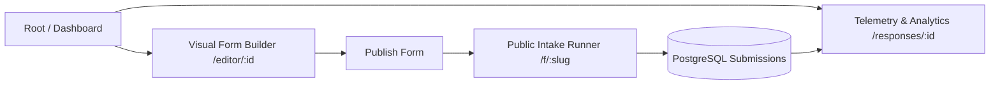
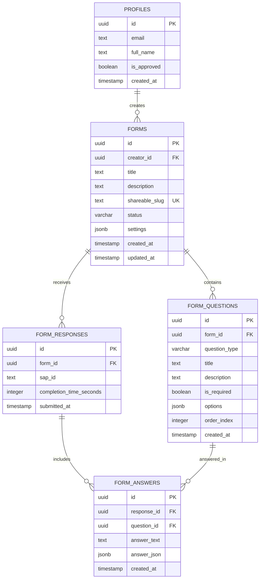

# Hypervision Form Platform — System Architecture & Technical Documentation

This document provides a comprehensive technical overview of the **Hypervision Form Platform**, including its functional capabilities, system architecture, component hierarchy, data models, and runtime flows.

---

## Table of Contents
1. [Product Overview & Design Philosophy](#1-product-overview--design-philosophy)
2. [Functional Capabilities & User Flows](#2-functional-capabilities--user-flows)
   - [2.1 Frictionless Workspace Dashboard](#21-frictionless-workspace-dashboard)
   - [2.2 Real-Time Visual Form Builder](#22-real-time-visual-form-builder)
   - [2.3 Public Intake & Submission Runner](#23-public-intake--submission-runner)
   - [2.4 Telemetry & Analytics Engine](#24-telemetry--analytics-engine)
3. [System Architecture](#3-system-architecture)
   - [3.1 High-Level Architecture Diagram](#31-high-level-architecture-diagram)
   - [3.2 Frontend Architecture (Next.js 15)](#32-frontend-architecture-nextjs-15)
   - [3.3 Database & Security Layer (Supabase / PostgreSQL)](#33-database--security-layer-supabase--postgresql)
4. [Project Structure & File Organization](#4-project-structure--file-organization)
5. [Database Schema & Data Models](#5-database-schema--data-models)
   - [5.1 Entity Relationship Diagram](#51-entity-relationship-diagram)
   - [5.2 Table Definitions](#52-table-definitions)
   - [5.3 Row Level Security (RLS) & Policies](#53-row-level-security-rls--policies)
6. [Core Technical Workflows](#6-core-technical-workflows)
   - [6.1 Workspace Initialization Flow](#61-workspace-initialization-flow)
   - [6.2 Form Creation & Auto-Save Flow](#62-form-creation--auto-save-flow)
   - [6.3 Public Form Submission Flow](#63-public-form-submission-flow)
   - [6.4 Response Telemetry & CSV Export Flow](#64-response-telemetry--csv-export-flow)
7. [Security & Hardening Standards](#7-security--hardening-standards)
8. [Setup, Deployment & Environment Variables](#8-setup-deployment--environment-variables)

---

## 1. Product Overview & Design Philosophy

**Hypervision Form Platform** is a reactive web application designed for creating, distributing, and analyzing dynamic intake forms. It features a cyber-sleek, dark-mode aesthetic (custom ASCII digital rain backdrop, neon accenting, and Google Material Symbols) paired with low-latency client-side state synchronization.

### Key Tenets:
- **Zero-Friction Access:** No gating or login hurdles for workspace operators. Opening the root domain immediately provides full access to create, edit, manage, and analyze forms.
- **Client-Driven Resilience:** Direct PostgreSQL/Supabase interaction from the browser leveraging Row Level Security (RLS), with built-in RPC fallbacks to ensure submissions never fail.
- **Optimistic Auto-Saving:** Changes made inside the visual editor are immediately reflected on the canvas and synced in the background with debounced persistence.
- **Strict Public Isolation:** Public respondent intake paths (`/f/[slug]`) are stripped of administrative telemetry, owner references, and internal metadata to prevent data leaks.

---

## 2. Functional Capabilities & User Flows



### 2.1 Frictionless Workspace Dashboard (`/dashboard`, `/`)
- **Centralized Form Hub:** Displays all workspace forms in either an interactive **Grid View** or dense **Table View**.
- **Real-Time Search & Filtering:** Filter forms dynamically by title/description, or by lifecycle state (`all`, `published`, `draft`, `closed`).
- **Keyboard Shortcut:** Instant global search activation using `Ctrl+K` / `⌘K`.
- **Form Lifecycle Management:**
  - **Create Blank or Template:** One-click instant creation of blank forms or pre-populated templates (e.g., Customer Feedback / CSAT Survey, Membership Intake).
  - **Inline Renaming:** Rename forms directly with reactive state updates.
  - **Status Toggling:** Single-click toggle between `draft` and `published` states.
  - **Public Link Copying:** Direct link extraction for published forms.
  - **Deletion:** Confirmation-protected cascading deletion of forms and associated responses.
- **Quick Navigation:** Instant action buttons to navigate directly to **Edit** (Builder) or **Responses** (Telemetry).

### 2.2 Real-Time Visual Form Builder (`/editor/[id]`)
- **Interactive Question Palette:** Supports 9 field types:
  1. `short_text` (Single line text input)
  2. `paragraph` (Multi-line textarea)
  3. `email` (RFC-compliant email input with validation)
  4. `multiple_choice` (Single selection radio list)
  5. `checkboxes` (Multi-selection option groups)
  6. `dropdown` (Native/styled selection menu)
  7. `scale` (Configurable rating scale — 1-5 or 1-10; Stars or Numerical steps)
  8. `date` (Standardized date picker)
  9. `file` (Document/attachment upload)
- **Granular Field Controls:** Required toggle, custom placeholder, help text, option adding/reordering/removal, and scale label customization (min/max descriptive labels).
- **Drag & Reorder:** Reorder questions vertically with automatic `order_index` rebalancing.
- **Live Canvas Preview:** Toggle between editor mode and an interactive preview canvas mimicking the public respondent experience.
- **Publish & Share Control:** One-click deployment with instant shareable URL generation (`/f/[slug]`).

### 2.3 Public Intake & Submission Runner (`/f/[slug]`)
- **Target Audience:** Unauthenticated external respondents.
- **Security Scoping:**
  - Verifies that form status is `published`.
  - Rejects submissions if form is `draft` or `closed`.
- **Completion Telemetry:** Automatically tracks respondent dwell time (`completion_time_seconds`) from initial load to submission.
- **Submission Guarantee:**
  - Generates client-side UUIDs to batch insert records atomically.
  - Features an automated RPC fallback (`submit_form_response_secure`) when strict client policies restrict direct multi-table inserts.
- **Responsive Layout:** Optimized for mobile touch targets and desktop accessibility.

### 2.4 Telemetry & Analytics Engine (`/responses/[id]`)
- **Executive Metric Cards:**
  - **Total Responses:** Total count of submissions received.
  - **Form Intake Status:** Visual badge displaying whether intake is live, closed, or in draft.
  - **Average Completion Time:** Computed arithmetic mean across submissions.
  - **Last Submission:** Relative timestamp of the latest response.
- **Tab 1 — Summary Analytics:**
  - Automated question-by-question aggregation.
  - Visual frequency bars for multiple choice, checkboxes, and dropdowns.
  - Average score calculations and distribution bar charts for rating/scale inputs.
  - Response percentage indicators (`X / Total replied`).
- **Tab 2 — Individual Submissions:**
  - Detailed response browser with per-submission inspection.
  - Direct timestamp, SAP/Participant ID tracking, and question-answer mapping.
- **CSV Data Export:** One-click export downloading sanitized, properly formatted `.csv` files containing all question columns and respondent answers.

---

## 3. System Architecture

### 3.1 High-Level Architecture Diagram

```
                                  ┌───────────────────────────────────────────┐
                                  │            Browser / Client               │
                                  └─────────────────────┬─────────────────────┘
                                                        │
                                                        │ HTTPS / WebSocket (PostgREST & GoTrue)
                                                        ▼
                                         ┌─────────────────────────────┐
                                         │     Next.js 15 Frontend     │
                                         │                             │
                                         │ • / (Root / Dashboard)      │
                                         │ • /editor/[id] (Builder)    │
                                         │ • /responses/[id] (Metrics) │
                                         │ • /f/[slug] (Intake Runner) │
                                         └──────────────┬──────────────┘
                                                        │
                                                        │ Direct Client-to-Supabase (with RLS)
                                                        ▼
                                         ┌─────────────────────────────┐
                                         │    Supabase (PostgreSQL)    │
                                         │                             │
                                         │ • forms & form_questions    │
                                         │ • form_responses & answers  │
                                         │ • profiles & audit tables   │
                                         │ • Row Level Security (RLS)  │
                                         │ • Stored Functions / RPCs   │
                                         └─────────────────────────────┘
```

### 3.2 Frontend Architecture (Next.js 15)
- **App Router (`frontend/src/app`):** Uses modern React 19 Client and Server Components.
- **Client Session Manager (`frontend/src/lib/supabase/client.ts`):** Transparently provisions and maintains an authenticated workspace session (`ensureWorkspaceSession`) using Supabase Auth in the background, allowing zero-friction access while satisfying PostgreSQL RLS constraints.
- **Global Styling & Canvas:** Tailwind CSS paired with custom matrix ASCII digital rain backgrounds ([`AsciiRainBackdrop.tsx`](file:///a:/Projects/hypervision-form/frontend/src/components/AsciiRainBackdrop.tsx)) rendered via HTML5 2D Canvas.
- **Iconography:** Real vector icons loaded via Google Material Symbols Outlined and Lucide React.

### 3.3 Database & Security Layer (Supabase / PostgreSQL)
- **Relational Integrity:** Foreign keys with `ON DELETE CASCADE` ensure that deleting a form safely removes its questions, responses, and associated answers.
- **Row Level Security (RLS):** Every table has RLS enabled. Policies distinguish between authenticated workspace operators and unauthenticated public respondents (`anon`).
- **Definer Functions:** Database functions (e.g. `submit_form_response_secure`, `is_authorized_workspace_user`) execute with elevated privileges to guarantee atomic operations without exposing write access to the entire database.

---

## 4. Project Structure & File Organization

```
hypervision-form/
├── frontend/                              # Next.js 15 web application
│   ├── public/                            # Static assets
│   │   ├── favicon.ico                    # Hypervision tab favicon
│   │   └── hypervision-logo.png           # Neon circular brand logo
│   ├── src/
│   │   ├── app/
│   │   │   ├── dashboard/
│   │   │   │   └── page.tsx               # Central form management dashboard
│   │   │   ├── editor/
│   │   │   │   └── [id]/
│   │   │   │       └── page.tsx           # Visual schema builder & canvas
│   │   │   ├── f/
│   │   │   │   └── [slug]/
│   │   │   │       └── page.tsx           # Public respondent intake runner
│   │   │   ├── responses/
│   │   │   │   └── [id]/
│   │   │   │       └── page.tsx           # Response analytics & CSV export
│   │   │   ├── icon.png                   # Next.js App Router icon metadata
│   │   │   ├── layout.tsx                 # Root layout, Google fonts, metadata
│   │   │   └── page.tsx                   # Root page router (renders Dashboard)
│   │   ├── components/
│   │   │   ├── AsciiRainBackdrop.tsx      # Cyberpunk digital rain canvas
│   │   │   └── AuthForm.tsx               # Reusable authentication component
│   │   ├── lib/
│   │   │   ├── scale.ts                   # Rating scale serialization helpers
│   │   │   ├── supabase/
│   │   │   │   ├── client.ts              # Browser Supabase client & session init
│   │   │   │   └── server.ts              # Server-side Supabase client helpers
│   │   │   └── utils.ts                   # Styling utilities (clsx / twMerge)
│   │   └── middleware.ts                  # Edge HTTP middleware & security
│   ├── package.json                       # Node dependencies & npm scripts
│   ├── tsconfig.json                      # TypeScript configuration
│   └── .env.local                         # Frontend environment configuration
│
├── supabase/                              # Database architecture & migrations
│   └── migrations/
│       ├── 20261102000001_initial_schema.sql                  # Core tables, enums, constraints, base triggers
│       └── 20261106000002_zero_backend_rls_audit.sql          # Unified strict RLS, public policies & secure RPCs
│
├── DOCUMENTATION.md                       # Complete technical & architectural docs
├── DEVELOPMENT_PLAN.md                    # Implementation roadmap & history
└── README.md                              # Project quickstart & overview
```

---

## 5. Database Schema & Data Models

### 5.1 Entity Relationship Diagram



### 5.2 Table Definitions

| Table | Primary Key | Description |
| :--- | :--- | :--- |
| `forms` | `id (UUID)` | Form records with title, description, URL slug (`shareable_slug`), and lifecycle state (`draft`, `published`, `closed`). |
| `form_questions` | `id (UUID)` | Questions belonging to a form. Stores `question_type`, ordering index (`order_index`), required flag, and configurable JSON options. |
| `form_responses` | `id (UUID)` | Individual submission headers linked to a form. Records completion duration and submission timestamp. |
| `form_answers` | `id (UUID)` | Granular answers submitted for each question within a response. Supports plain text (`answer_text`) and structured JSON (`answer_json`). |
| `profiles` | `id (UUID)` | User directory tracking account attributes and verification status. |

### 5.3 Row Level Security (RLS) & Policies
- **`forms` & `form_questions`:**
  - Workspace operators have full `SELECT`, `INSERT`, `UPDATE`, `DELETE` permissions.
  - Unauthenticated public users (`anon`) have `SELECT` access exclusively for published forms (`status = 'published'`).
- **`form_responses` & `form_answers`:**
  - Unauthenticated respondents (`anon`) have `INSERT` permission to submit completed forms.
  - Workspace operators have `SELECT` and `DELETE` permissions to analyze and manage submissions.

---

## 6. Core Technical Workflows

### 6.1 Workspace Initialization Flow
When an operator visits `http://localhost:3000`:
1. Next.js App Router renders `frontend/src/app/page.tsx`, which directly mounts `DashboardPage`.
2. [`ensureWorkspaceSession()`](file:///a:/Projects/hypervision-form/frontend/src/lib/supabase/client.ts) verifies if an active session exists. If not, it transparently authenticates with Supabase using default workspace credentials.
3. The dashboard executes a PostgREST query on `forms`, retrieving all forms, ordering by `created_at DESC`.
4. Simultaneously, a response count aggregation calculates the total submissions per form.
5. The view renders with full interactive capabilities (New Form, Search, Edit, Responses, Rename, Delete).

### 6.2 Form Creation & Auto-Save Flow
1. Clicking **New Form** generates a unique slug (e.g., `form_1730000000_abc12`) and inserts a new row into `forms`.
2. The user is redirected to `/editor/[id]`.
3. Changes to the form title, description, or question fields trigger debounced state mutations.
4. Updates are pushed to Supabase via `.update()` calls. Reordering questions updates the `order_index` sequence in batch.
5. Toggling **Publish** updates `status: "published"`, activating the public intake URL.

### 6.3 Public Form Submission Flow
1. A respondent navigates to `/f/[slug]`.
2. The page loads only published schema details (`title`, `description`, `form_questions`).
3. Dwell time tracking initializes via `performance.now()`.
4. Upon clicking **Submit**:
   - Client-side validation ensures all `is_required` fields are satisfied.
   - A new `form_responses` UUID is generated.
   - Answers are prepared and inserted into `form_responses` and `form_answers`.
   - If direct table insertion encounters client RLS hurdles, the runner falls back to the database RPC function `submit_form_response_secure`.
   - A success state displays the submission confirmation.

### 6.4 Response Telemetry & CSV Export Flow
1. The operator clicks **Responses** on the dashboard or editor.
2. The page `/responses/[id]` fetches:
   - Form metadata.
   - Form questions list.
   - All `form_responses` records.
   - All corresponding `form_answers` in URL-safe batches.
3. Real-time metrics compute:
   - Total responses count.
   - Average completion time in seconds/minutes.
   - Aggregate choice distribution for multiple choice, checkboxes, and rating scales.
4. Clicking **Export CSV**:
   - Assembles question titles into CSV column headers.
   - Maps each response row to its answers.
   - Sanitizes text against CSV injection formulas (escaping `=`, `+`, `-`, `@`).
   - Generates a downloadable blob formatted as `<form_title>_telemetry_<date>.csv`.

---

## 7. Security & Hardening Standards

- **Row Level Security (RLS):** All data access is bounded by PostgreSQL security policies enforced directly at the database engine.
- **HTTP Security Headers (`frontend/next.config.ts`):**
  - `Content-Security-Policy`: Restricts script and resource execution.
  - `X-Frame-Options: DENY`: Prevents clickjacking attacks.
  - `X-Content-Type-Options: nosniff`: Mitigates MIME-type sniffing.
  - `Referrer-Policy: strict-origin-when-cross-origin`: Restricts referrer information leakage.
- **PII Stripping:** Public intake endpoints never return creator IDs, internal user emails, or other forms' configurations.
- **CSV Formula Injection Mitigation:** All cell exports escape leading control characters to safeguard spreadsheet software.

---

## 8. Setup, Deployment & Environment Variables

### Environment Variables

#### Frontend (`frontend/.env.local`)
```env
NEXT_PUBLIC_SUPABASE_URL=https://your-supabase-project.supabase.co
NEXT_PUBLIC_SUPABASE_ANON_KEY=your-supabase-anon-key
SUPABASE_SERVICE_ROLE_KEY=your-supabase-service-role-key
ADMIN_EMAIL=admin@gmail.com
```

### Running Locally

```bash
# 1. Database Migrations
# Run migrations from supabase/migrations/ in sequential order

# 2. Frontend Launch
cd frontend
npm install
npm run dev
# Running at http://localhost:3000
```

